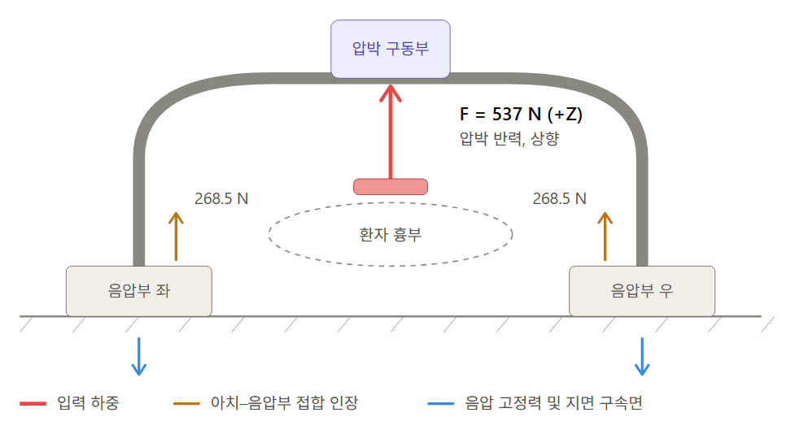

# 설계

## 구동부

압박 속도는 110 BPM으로 고정하고, 볼스크류 리드 10 mm·감속비 1.5의 조합으로
모터(BL60120-2430)의 각속도를 압박 속도로 변환한다.

## 진공 고정부

목표 압력은 −22.5 kPa(허용오차 ±2.5 kPa)이다. 블로워(BL6561-P, 24 V)의 dead-head 정압은 약 27.3 kPa로, 초기 목표였던 −30 kPa는 도달할 수 없다. 유지력은 F = ΔP·A로 산정하며 아래 값은 명목 면적 기준 계산값(`simulated`)이다. @tbl-vac 은 진공계통 확정값을 정리한다.

| 항목 | 값 |
|---|---|
| 목표 압력 | −22.5 kPa |
| 허용오차 | ±2.5 kPa |
| 명목 유지력 (−20 kPa × 0.18 m², 계산) | 3600 N |
| 바닥 갭별 운전 음압 (보정 전 CFD, 24 V 팬 커브) | 0.05~0.30 mm → −27.0~−17.6 kPa |

: 진공 고정부 확정값 {#tbl-vac}

@fig-loadpath 는 하중 경로와 경계조건 개요다.

{#fig-loadpath}
